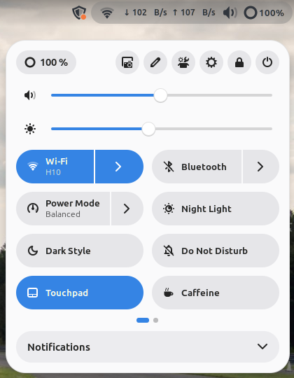

# LMQS — Linux Mint Quick Settings

**LMQS** is a Cinnamon panel applet that brings GNOME Shell's Quick Settings to Linux Mint: one menu with pill toggles, round buttons, sliders and slide-out submenus, the way GNOME (and Android) does it. Everything about it can be customized.

Author: Henry henz · https://henzljw.vercel.app/




## Why this exists

I'm an Android enthusiast, and the Quick Settings panel is one of my favourite things about Android: swipe down, and Wi-Fi, Bluetooth, brightness, Do Not Disturb and the rest are one tap away.

When I used Linux Mint, I missed that. Cinnamon spreads these controls across separate places: a network applet, a sound applet, a power applet, a Bluetooth applet, and System Settings for things like Night Light or switching between light and dark themes. Turning a few of them on or off meant opening several different menus and windows.

It was only after I switched to GNOME that I had a proper Quick Settings menu on the desktop: everything in one place, laid out like Android's. I liked it so much that I wanted the same thing on Linux Mint, without having to leave Cinnamon behind.

That's why LMQS exists. It brings a GNOME-style Quick Settings menu to Linux Mint Cinnamon, replaces the separate network, sound and power applets with one button, and adds the Android touches I wanted: pages of tiles you can rearrange, a compact row when notifications are open, a media player card, and your own custom tiles.

## What's inside

**Top row:** battery pill, Screenshot, Edit tiles (pencil), Quick Settings settings, System Settings, Lock and Power. Hover over any button to see its name. Power opens Suspend / Restart… / Power Off… / Log Out….

**Sliders**
| Slider | Extra |
|---|---|
| Volume | Click the speaker to mute. Use `>` to pick an output (speakers, headphones, HDMI, Bluetooth) |
| Microphone | Shown while an app is using the mic (configurable). Use `>` to pick an input |
| Brightness | Screen backlight |

**Tiles**

A fresh install shows **Wi-Fi, Bluetooth, Power Mode, Night Light, Dark Style and Do Not Disturb**, like GNOME. Every other tile starts in the hidden tiles: add it with the pencil button or on the **Tiles** page of the settings window. A tile your computer can't use yet (no Ethernet port, no rotation sensor, app not installed…) stays available but dimmed, with the reason underneath.

| Tile | What it does |
|---|---|
| Wi-Fi | On/off; `>` lists networks you can join |
| Wired | Connect or disconnect Ethernet |
| Bluetooth | On/off; `>` lists paired devices |
| VPN | Connect or disconnect; `>` picks a VPN or WireGuard connection |
| Power Mode | Balanced / Performance / Power Saver (needs power-profiles-daemon) |
| Night Light | Warmer colours in the evening |
| Dark Style | Switches GTK + Cinnamon theme between light and dark |
| Do Not Disturb | Hides notification pop-ups |
| Caffeine | Keeps the screen from dimming, locking or sleeping until you turn it off |
| Keyboard | Keyboard backlight on/off; `>` has brightness levels or lighting modes |
| Refresh Rate | Switches between your screen's highest rate and 60 Hz; `>` lists every rate (X11) |
| Microphone | Mutes or unmutes your default mic |
| Camera | Privacy block: unloads the webcam driver so no app can use the camera (one-time setup below) |
| Auto Rotate | Screen rotation on/off (2-in-1s with a rotation sensor) |
| Hotspot | Shares your connection over Wi-Fi |
| Touchpad | Turns the touchpad off or on; asks first and checks that a USB or Bluetooth mouse is connected |
| Airplane Mode | Turns all radios off or on |
| Screenshot | Takes a screenshot; `>` picks whole screen, window or area |
| Terminal | Opens your default terminal |
| Update Manager | Opens Update Manager; shows how many updates are waiting |
| NVIDIA Settings | Opens NVIDIA Settings; shows the current graphics mode |
| Discord | Opens Discord (or brings it to the front) |
| Custom tiles | Your own: open an app, a folder or website, or run on/off commands |

**Pages:** every page keeps the same height, even when the last one has fewer tiles. You can turn this off in Appearance, so short pages shrink to fit. Tiles fill each page **4 rows deep** (adjustable from 2 to 6 rows in Appearance), and the rest continue on the next page, like Android. Switch pages with the dots under the tiles, or scroll over the tiles.

**Edit mode (pencil button):** tiles don't switch on or off while you edit. There are two ways to move them:
- **Tap a tile** to select it (white outline). A toolbar appears with **Previous page**, **Move back**, **Move forward**, **Next page** and **Hide** (or **Show**).
- Drag a tile to move it.
- Hold it at the left or right edge to move it to the previous or next page.
- Drag it into **Hidden tiles** to hide it, or drag a hidden tile back out.
- **Done** saves your layout. **Cancel** throws your changes away.
- Changes aren't saved until you press **Done**. If you leave edit mode another way with unsaved changes (the pencil button, Cancel, or closing Quick Settings), a window asks whether to **Save**, **Discard** or **Keep Editing**.

**Notifications:** Cinnamon notifications collect at the bottom of Quick Settings.
- Tap the **Notifications** header to drop the list down (animated). Like Android, the tiles then shrink to a single row of round buttons. That's 6 at GNOME's width, and more when you use 3–5 columns (10, 12 or 15) so the row is filled. The volume slider tucks away.
- Tap the header again to bring the full tiles back.
- Click a notification to open it, use **×** to dismiss it, or **Clear all** under the list to remove them all.
- Choose where notifications appear in Configure › Layout › Extras: **below, above, left or right** of Quick Settings. On the left or right they get their own column, and the list is always open.

**Fits your screen:** Quick Settings never grows taller than the space between your panels. If there's more content, it scrolls.

**Media card:** when Spotify, a browser or any other player is playing, a card shows the album art, title and artist, with previous / play-pause / next buttons. Click the card to bring the player to the front. The **enlarge** button turns it into an Android-style big player with large album art, a **seek bar** with elapsed and total time, and big controls. Shrink it back with the same corner button. Quick Settings remembers which size you chose.

## Settings window
Quick Settings has its own settings window in a clean GNOME preferences layout that follows your GTK theme. It's built from the same list of options as Cinnamon's, so nothing is missing:
- A home page with the app header (name, author, version) and a list of pages: Tiles, Custom Tiles, Layout, Panel and Appearance, plus **About** (Details, Credits and Legal). Each row slides into its page; the back arrow returns.
- Option cards, accent-color swatches plus a color picker, and a tile list with show switches and up/down buttons.

It opens from the Quick Settings settings button and from right-click › Configure, on the left side of the screen. While it's open, **Quick Settings stays open as a live preview**: every change shows up in it immediately, and you can still click tiles in the preview. Each change animates in the preview: the contents fade out, take the new layout or colours, and fade back in. The preview stays open for as long as the settings window is open, even if something else tries to close it. Clicking the panel button closes Quick Settings and minimizes the settings window with it; clicking the panel button again (or restoring the settings window) brings both back. Minimizing the settings window hides the preview too. Restoring the window brings the preview back, and clicking the Quick Settings panel button brings both back together, with the window returning to how it was (still maximized if it was maximized). Closing the settings window ends the preview. If it can't start (Python GTK missing), Cinnamon's standard settings window opens instead.

## Customize

**Custom tiles:** the **Custom Tiles** page in the settings window lets you add your own tiles:
- **Open an app:** pick from your installed apps. If the app is already open, its window is brought to the front.
- **Open a folder or website:** folders open in Files, websites in your browser (`~/Downloads`, `example.com`).
- **Command toggle (advanced):** an on/off tile with an On command, an Off command and an optional Status command (the tile shows *on* when it exits with 0). Commands run as you, in a shell.

After you add a tile you're asked whether to put it in Quick Settings now (it goes to the end of the grid) or keep it with the hidden tiles. Move, show or hide them with the pencil button like any other tile. *Reset Everything* also removes custom tiles.

**Scrolling:** *Panel › Behaviour* has separate switches for changing the volume by scrolling over the panel icons with the **mouse wheel** and with the **touchpad** (two fingers). In *Layout › Sliders*, the volume, brightness and microphone sliders each have their own scrolling option: mouse wheel and touchpad, mouse wheel only, touchpad only, or off. When a slider ignores a scroll, Quick Settings scrolls instead.

**Network speed in the panel:** turn on *Panel › Network › Show download and upload speed* to see the current speed next to the Wi-Fi or wired icon, updated every second (for example `↓ 1.2 MB/s  ↑ 34 KB/s`). *Speeds to show* picks download and upload, download only, or upload only. Loopback, Docker/VM and VPN tunnel interfaces aren't counted, so traffic isn't counted twice. It's hidden when you're offline and on vertical panels.

**Menu style for the whole system:** in *Appearance › Look*, turn on **Apply the menu style to the whole system**. Choosing Dark or Light for the menu then also switches your apps, windows and Cinnamon theme (the same as the Dark Style tile), with no trip to System Settings. It works the other way too: the Dark Style tile changes the menu style. With *Follow system style* the menu just follows your system theme.

**Reset to defaults:** the **Reset** button at the top left of the settings window starts your customization from scratch. You can reset just the page you're on or everything. Remembered states like your refresh rate and keyboard lighting are kept, and Quick Settings animates back to the defaults.

**Battery time remaining:** under *Panel › Battery › Battery time remaining*, choose where to show the time left in hours and minutes (for example `3 h 25 min`, or `1 h 10 min to full` while charging): **Disabled**, **On the Quick Settings button (panel)**, **Inside Quick Settings** (under the percentage in the battery pill), or **Both**. It's hidden while the system is still estimating, and the panel text is hidden on vertical panels.

Every tile is always available to add, even when its hardware or connection isn't there. Wired with no Ethernet port, VPN with nothing set up, Auto Rotate with no rotation sensor, and so on show as dimmed tiles saying why. Clicking one opens the relevant settings where that helps (VPN opens the connection editor to add a VPN). Hide any you don't want with the pencil (edit) button or in the settings window.

Click the **Quick Settings settings** button in the top row (next to the pencil), or right-click the applet and choose **Configure…**.

- **Tiles**
  - Turn each tile on or off, and put them in your own order with the arrows.
- **Custom Tiles**
  - Make your own tiles. After adding one you choose whether it goes into Quick Settings now or stays with the hidden tiles.
- **Layout**
  - Show or hide each slider, the output and input pickers, each top-row button, and the media card.
  - Choose when the microphone slider appears: while it's in use, always, or never.
- **Panel**
  - Choose which panel icons appear, and turn scroll-to-change-volume on or off.
  - **Battery icon:** System icon (from your theme), Horizontal, Vertical or Circle.
  - **Battery percentage:** Hidden, Beside the icon (right next to it), or Inside the icon. Inside works with Horizontal, Vertical and Circle. The System icon shows the percentage Hidden or Beside only, because theme battery icons can't hold a number cleanly.
  - The battery pill at the top of Quick Settings follows the same two settings, and both update the moment you change them.
  - The drawn icons turn green while charging and red at 15% or below. Charging also shows a lightning bolt when the percentage isn't inside.
- **Appearance**
  - Dark card (GNOME's look), light card, or one that follows Dark Style.
  - Any accent color. With light colors such as yellow, mint or orange, text on the toggles switches to dark so it stays readable.
  - 1 to 5 toggle columns (the menu widens for 3 or more) and 2 to 6 tile rows per page.
  - Animations: Off, Fast, Normal (GNOME's speed) or Slow. The menu fades and slides in from the panel. Submenus fade and slide in with a rotating arrow, the rest of the menu fades while one is open, and toggle colors blend on hover and click. Animations only move and fade things (no per-frame re-layout), and status refreshes wait until an animation finishes, so they stay smooth.

## Install

```bash
unzip lmqs.zip && cd lmqs
chmod +x install.sh uninstall.sh

./install.sh             # installs, places it on the right and removes Mint's Sound, Network and Battery applets
./install.sh --keep-mint # same, but keeps Mint's Sound, Network and Battery applets
./install.sh --no-add    # only copies the files
./install.sh --camera    # also sets up the Camera toggle (asks for your password once)
```

### Camera toggle setup
The Camera toggle unloads the `uvcvideo` webcam driver and blocks it from loading again, so no app can reach the camera. Turning a driver off needs administrator rights, so the installer adds two small system files once:
- Small helpers in `/usr/local/libexec/` (`gqs-camera`, `gqs-camera-on`, `gqs-camera-off`).
- A polkit rule that controls who can run them.

Turning the camera off or on takes one click. No password is needed, only the one-time setup.

When you run `./install.sh` in a terminal, it asks you about this setup. You can also use `--camera` or `--no-camera`.

- If an app is using the camera, it can't be turned off. Close the app and try again.
- Most laptop and USB webcams use `uvcvideo`. Some newer Intel laptops use a different (MIPI/IPU6) camera driver that this toggle doesn't block.
- `./uninstall.sh` turns the camera back on and removes these files.

Quick Settings replaces Mint's own Sound, Network and Battery (Power) applets, so the installer removes them from the panel. Uninstalling puts them back. The applet always goes to the right side of the panel, just left of the clock as in GNOME. If the clock is in the center, or there's no clock, it goes at the right end. Running the installer again moves the applet back there if it was moved, and keeps your settings. Before changing anything the first time, the installer saves your panel layout to `~/.config/lmqs-applets.bak`. After updating, restart Cinnamon with **Ctrl+Alt+Esc**.

**Coming from "GNOME Quick Settings"** (LMQS's earlier name): just run `./install.sh`. It replaces the old applet in the same spot on your panel, moves your settings and custom tiles over, and removes the old files.

### Optional packages
```bash
sudo apt install power-profiles-daemon gnome-screenshot fonts-cantarell iio-sensor-proxy
```
- `power-profiles-daemon`: needed for Power Mode.
- `fonts-cantarell`: GNOME's font, so the text matches exactly.
- `iio-sensor-proxy`: needed for Auto Rotate on 2-in-1 laptops.

## Lenovo Legion RGB keyboard
On Legion laptops with a 4-zone RGB keyboard (ITE 8295 controller, USB ID `048d:c9xx`), the Keyboard toggle gives you:
- **Brightness:** Off / Low / High. Clicking the toggle turns the light off or back on.
- **Effects:** Static, Breathing, Wave and Color cycle.
- **Colors:** one-tap swatches (white, red, orange, yellow, green, cyan, blue, purple and pink) and a 4-zone rainbow.

Changing the lighting needs permission to talk to the controller. The installer asks once and adds a small udev rule (`/etc/udev/rules.d/70-gqs-legion-rgb.rules`), so it works without a password afterwards. Your lighting is restored after login. **Fn+Space** still works, but on most Legion models the keyboard changes the lighting by itself without telling Linux, so Quick Settings can't show those changes. Quick Settings checks once at login. If your controller does report its lighting, it follows Fn+Space changes within about 2 seconds.

## Refresh rate notes
- Changes apply instantly through `xrandr`. Quick Settings remembers the rate you picked and puts it back after you log in. You can turn that off under Configure › Layout › Extras.
- With an external monitor connected, the `>` list shows rates for each screen. Clicking the toggle itself controls the built-in screen.
- 60 Hz uses less battery. The highest rate gives the smoothest motion.
- Many 144/165 Hz laptop screens only report their top rate to Linux. In that case Quick Settings adds 144, 120 and 60 Hz modes (whichever are below the top rate and missing), built from the screen's own timings with only the pixel clock slowed down.  Every time you change the refresh rate, a **Keep this refresh rate?** box appears. If you don't click **Keep Changes** within 15 seconds, it switches back automatically, even if the screen went dark.

## Starts with your computer
Quick Settings starts automatically every time you log in, because Cinnamon loads every applet on your panel at login. The installer puts it on the panel for you, so no extra startup entry is needed. Adding one in Startup Applications would start a second copy.

If some services are still starting when you log in (brightness, keyboard backlight, Bluetooth, network, power modes, rotation sensor), Quick Settings connects to them as soon as they're ready and checks again 5 and 15 seconds after login. Nothing stays missing until a restart.

## Bluetooth at login

Linux (BlueZ) switches Bluetooth on at every boot, and Bluetooth Manager (Blueman) can switch it on too. In *Layout › Extras › Bluetooth at login*, choose **Always off** to keep it off. Quick Settings applies your choice for the first minute after login, after waking from suspend, and whenever the adapter reappears. *Always off* also turns off Blueman's own "power on automatically".

To stop it at boot entirely (before you even log in), run `./install.sh --bt-boot-off`, or answer **y** when the installer asks. This sets `AutoEnable=false` in `/etc/bluetooth/main.conf`; a backup is kept and `uninstall.sh` puts it back.

## Settings windows
Settings buttons in Quick Settings (Customize, Settings, All Networks, Sound Settings and so on) open each settings page only once. If that window is already open, clicking again brings it to the front instead of opening a second copy.

## Uninstall
```bash
./uninstall.sh   # removes the applet and restores your original panel, including Mint's Sound, Network and Battery applets
```

## Troubleshooting
- For error logs, press Alt+F2, type `lg` and open the **Log** tab. Look for lines starting with `[gqs]`.
- If a toggle you ticked doesn't appear, your computer probably doesn't have that hardware or service (see "Shows when" above).
